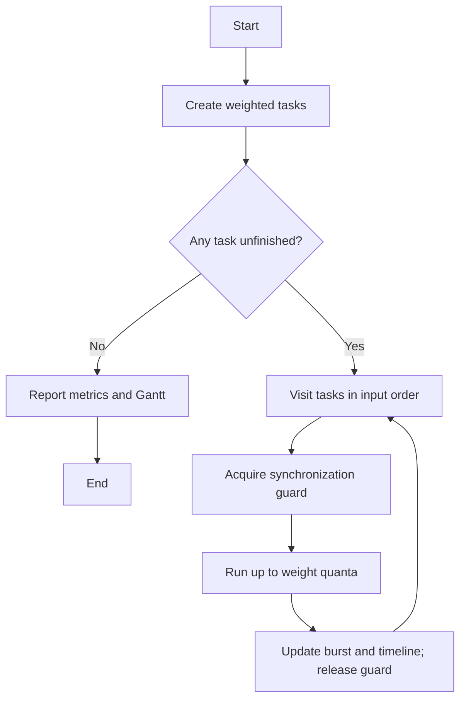

# Exercise 5 — Weighted Round Robin with Synchronization

Compares Semaphore, Monitor, and combined Semaphore + Monitor guards around the repository's Weighted Round Robin policy.

Each runnable task receives up to `weight` quanta per round. A final slice is shortened to its remaining CPU burst; completed tasks are skipped. Idealized share: `weight(i) / sum(weights) * 100%`.

- Semaphore: binary semaphore protects dispatch updates.
- Monitor: condition-based monitor protects shared state.
- Both: acquire semaphore then monitor, release in reverse order.

The simulation is deterministic and uses a single dispatcher so all variants can be compared on identical workloads. It illustrates critical-section protection, not parallel speedup.

Run `python exercise5_wrr.py --mode all --quantum 1` and `python -m unittest -v`.

Metrics: completion/turnaround time, waiting time (turnaround minus CPU burst), and makespan. This is a scheduling simulation, not a real OS process controller or CPU benchmark.
